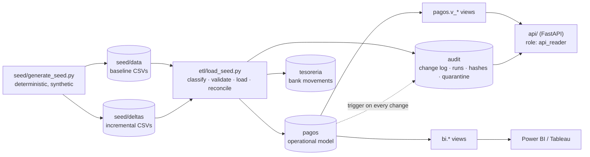

# payments-data-platform

[](https://github.com/lautarobermudez/payments-data-platform/actions/workflows/ci.yml)

A PostgreSQL data model, an incremental load pipeline with a full audit trail, and a read-only REST API for the **payment orders** of a small group of companies: who pays, to whom, how, how much, and in which status. It also holds bank movements and exposes flat views for BI tools.

I built the original for a real group of companies, replacing spreadsheets that lived in folders. This repository is a clean rebuild of that design on **fully synthetic data**: no real names, tax ids, bank accounts or amounts.

## What it shows

- **Relational modelling:** 18 tables in 4 schemas, with constraints that carry business rules (CUIT and CBU formats, partial unique indexes, triggers).
- **A safe, incremental ETL:** dry-run by default; new orders are inserted, changed ones updated and unchanged ones skipped (content hash); invalid rows go to a quarantine instead of stopping the load; a reconciliation step rolls everything back if the database does not match the source.
- **Traceability:** a trigger records every change (old and new row, who, which run); every execution is logged, including dry-runs and failures.
- **A read-only REST API (FastAPI):** orders with their history, suppliers, accounts payable and aging, and the run log. Read-only and "no bank data" are enforced by the database role, not by the application code.
- **Data quality as tests:** 16 SQL rules that must return zero violations, plus 61 tests, run in CI.
- **A BI-ready layer:** a `bi` schema of stable, flat views that Tableau and Power BI connect to (see the companion repository, [payments-bi-dashboards](https://github.com/lautarobermudez/payments-bi-dashboards)).
- **Reproducibility:** a deterministic seed generator, incremental file sets, CI that proves it, and `make demo` to run the whole thing.

## Architecture



More in [docs/ARCHITECTURE.md](docs/ARCHITECTURE.md) (a load run step by step, the incremental logic, the audit trail, error handling, the security model and the limits) and [docs/DECISIONS.md](docs/DECISIONS.md) (why each choice was made, and what it costs).

## Quick start

Requirements: Docker, `psql`, Python 3.10+.

```bash
python -m venv .venv && source .venv/bin/activate && pip install -r requirements.txt
make demo      # database, schema, seed, full load, two incremental loads, audit summary, and the API
```

`make demo` ends with the API running at <http://127.0.0.1:8000/docs>. If port 5432 is already taken by another PostgreSQL, use `make demo PG_PORT=5433`. `make reset` removes the database.

The same, step by step:

```bash
make up            # PostgreSQL 17 in Docker
make init          # schemas, tables, views, audit trail, read-only API role
make seed deltas   # generate the dataset and the incremental file sets
make load          # full load: dry-run, then commit
make load-deltas   # two incremental loads
make summary       # what the audit trail recorded
make api           # REST API on :8000
make test          # unit tests, data-quality rules, integration and API tests
```

## What a load looks like

The second incremental file carries a repeated order and two invalid rows on purpose. The valid rows load, the invalid ones go to quarantine, and the run is recorded:

```
Reconciliation: line total in database = 3,219,387.72 | in file = 3,219,387.72 (10 orders checked)

=== Load report ===
  order lines written                       11
  orders changed                             4
  orders new                                 5
  orders unchanged                           1
  rejected order                             2

=== Quarantined rows (audit.rejected_row) ===
  [order] payment_orders.csv:12 Alpha Trading S.A. OP92: supplier not loaded
  [order] payment_orders.csv:13 Beta Foods S.A. OP97: pendiente OP with a payment date

Committed.
Run 69c0c6c6-85dc-4938-93ed-e3240cb8ca93 recorded in audit.load_run (succeeded_with_rejects).
```

Loading the same file again changes nothing (all ten valid orders are reported as unchanged) and adds no row to the change history. If more than 20 % of a file is rejected, the run is aborted instead: see `--max-reject-rate`.

## The API

Ten `GET` endpoints; the contract is published at `/openapi.json` and documented at `/docs`.

| Endpoint | Returns |
|---|---|
| `/orders` | Payment orders, filtered (company, status, supplier, dates, amount, due date), sorted and paginated |
| `/orders/{id}` | One order with its lines, status history and the full change log |
| `/suppliers`, `/suppliers/{id}/statement` | Suppliers with pending and paid amounts; one supplier's statement with the running balance |
| `/payables/due` | Pending orders overdue or due within the next N days |
| `/payables/aging` | Pending amount by company and age against the due date |
| `/runs`, `/runs/{id}`, `/runs/{id}/rejects` | The ETL run log and the quarantined rows of each run |
| `/health` | Whether the API can reach the database |

`payables/*` take an `as_of` date, so a result can be reproduced for any day:

```bash
curl 'http://127.0.0.1:8000/payables/aging?as_of=2026-11-01'
```
```json
{ "as_of": "2026-11-01",
  "rows": [ { "company": "Alpha Trading S.A.", "not_due": 443870.49, "overdue_61_90": 242562.53, "overdue_over_90": 1288692.95, "total": 1976125.97, "...": "..." }, "..." ],
  "totals": { "company": "TOTAL", "not_due": 1229118.46, "overdue_1_30": 0.0, "overdue_31_60": 0.0,
              "overdue_61_90": 242562.53, "overdue_over_90": 2025500.41, "no_due_date": 2000.0, "total": 3499181.4 } }
```

**Security.** The API connects as `api_reader` (`db/06_api_role.sql`): read-only, queries cut after 5 seconds, and no access to bank accounts or to the raw change log. The tests check the role directly in PostgreSQL, not only through the API. There is **no authentication** on the API itself: see the limits below.

## Audit trail

The history of one order, straight from the database (it was loaded by the full load and paid by the first incremental file):

```
    at    |        table_name        | operation |     changed_fields     |     actor     |   run
----------+--------------------------+-----------+------------------------+---------------+----------
 18:28:22 | pagos.orden_pago         | INSERT    |                        | etl.load_seed | 10f96e8b
 18:28:22 | pagos.orden_pago_detalle | INSERT    |                        | etl.load_seed | 10f96e8b
 18:28:22 | pagos.orden_pago_detalle | INSERT    |                        | etl.load_seed | 10f96e8b
 18:28:22 | pagos.orden_pago_detalle | INSERT    |                        | etl.load_seed | 10f96e8b
 18:28:23 | pagos.orden_pago         | UPDATE    | {estado_id,fecha_pago} | etl.load_seed | fd0a47f7
```

The same history is available at `GET /orders/{id}`.

## Repository layout

```
db/            numbered SQL: 01 schema · 02 ERP-style views · 03 BI views · 04 treasury · 05 audit · 06 API role
db/tests/      data-quality rules (each query returns the rows that break a rule)
seed/          deterministic generator, the baseline CSVs and the incremental file sets (seed/deltas)
etl/           loader (incremental, quarantine, reconciliation), audit helpers and pure validators
api/           FastAPI application: routers, response models, database access
tests/         unit tests (no database), integration and API tests (each on a throw-away database)
docs/          architecture, decisions, data model, ER diagram, glossary, example queries
.github/       CI: schema, seed reproducibility, full and incremental loads, API smoke test, tests
```

## Limits

- **Not a production system.** The API has no authentication or rate limiting, and the credentials in the repository are for local use only.
- **Incremental by content hash applies to orders and their lines.** Suppliers and bank accounts are insert-only; bank movements are append-only.
- **File sources, one database, no scheduler.** A failed run is simply run again.
- **Synthetic data.** The design comes from a real system; nothing in this repository does.

The full list, with the reasoning, is in [docs/ARCHITECTURE.md](docs/ARCHITECTURE.md#8-limits-what-this-is-not).

## Notes

- **Language of the model:** identifiers keep the Spanish domain vocabulary (`orden_pago`, `tercero`, CUIT, CBU) because they are Argentine concepts with no exact English equivalent. Comments, docs and the code around it are in English; see the glossary in [docs/DATA_MODEL.md](docs/DATA_MODEL.md).
- **Scope:** this covers payments, bank movements, an audit trail and a read-only API. Sales invoicing, cheque management, authentication and write endpoints are not part of this repository.
- **How it was built:** I designed the model and the rules, and used Claude Code to speed up drafting; I reviewed and validated the output, and the tests and the reconciliation step exist to catch mistakes from any author.

## License

MIT, see [LICENSE](LICENSE).
