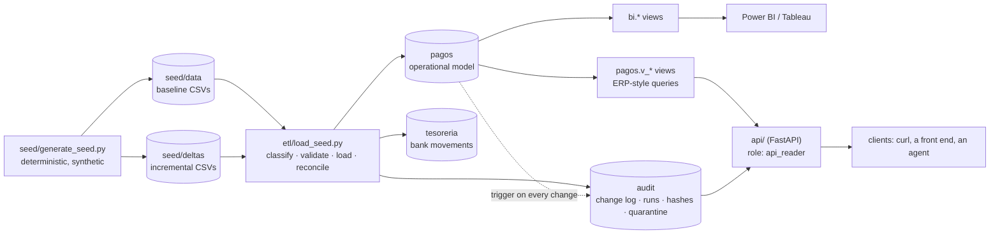

# Architecture

How the pieces fit together, what happens during a load, how the audit trail works and where the limits are.
The reasons behind each choice are in [DECISIONS.md](DECISIONS.md); the tables are described in [DATA_MODEL.md](DATA_MODEL.md).

## 1. Overview



Three ideas organise the system:

1. **Everything that enters goes through one loader**, and the loader never trusts its input: it validates, classifies and reconciles.
2. **Everything that changes is recorded**, by the database itself, so the record cannot be skipped by a new tool or a manual edit.
3. **Everything that leaves goes through views and a restricted role**, so the API cannot write and cannot see bank details even if its code has a bug.

## 2. One load run, step by step

```mermaid
sequenceDiagram
    participant U as User
    participant L as load_seed.py
    participant R as run log (own connection)
    participant DB as PostgreSQL (one transaction)
    U->>L: load --source seed/deltas/delta_2 --apply
    L->>R: INSERT audit.load_run (status = running)
    L->>DB: BEGIN; set app.actor and app.run_id
    loop every order in the file
        L->>L: validate, hash the content, classify
        alt invalid
            L->>L: keep in memory as a quarantined row
        else new / changed
            L->>DB: INSERT or UPDATE order and lines
            DB-->>DB: trigger writes audit.change_log
        else unchanged
            L->>L: skip
        end
    end
    L->>DB: reconcile: every row accounted for, line totals equal
    L->>L: reject rate above the limit?
    alt problems
        L->>DB: ROLLBACK
    else
        L->>DB: COMMIT (or ROLLBACK for a dry-run)
    end
    L->>R: UPDATE audit.load_run (status, counts, error) and store the quarantined rows
    L-->>U: report and exit code
```

The run record is written on a **separate autocommit connection**. A dry-run or a failed load rolls the main transaction back, and the record of that attempt must survive: a failed run is exactly the one you want to find later.

## 3. Incremental load

An order is identified by its natural key, `(company, OP number)`. An order without a number is identified by company, supplier and date. For each order the loader computes a **SHA-256 of its canonical content** (the header fields and every line, in a fixed order) and compares it with the hash stored in `audit.source_row`:

| Stored hash | Result | What the loader does |
|---|---|---|
| none | **new** | insert the order, its lines and the first status-history row |
| different | **changed** | update the header, write the status-history row if the status changed, upsert the lines and delete the ones no longer in the file |
| same | **unchanged** | nothing is written |

Two safety nets: if a hash exists but the order was deleted, it is loaded again; if the order exists but was loaded by an older version of the loader (no hash), it is compared as *changed*, and the audit trigger records only what really differs.

Consequences:

- **Re-running is safe.** The same file loaded twice touches nothing; the second run reports every order as unchanged and adds no row to the change log.
- **Partial files work.** A file set can carry only new or changed orders (`seed/deltas/*`); suppliers and bank accounts are looked up in the database when they are not in the file.
- **A failed run leaves nothing behind**, so the fix is "correct the file and run it again".

## 4. The audit trail

| Table | What it holds |
|---|---|
| `audit.change_log` | One row per `INSERT`, `UPDATE` or `DELETE` on `pagos.orden_pago`, `orden_pago_detalle`, `tercero`, `comprobante` and `cuenta_bancaria`: the old and new row as JSON, the columns that changed, who (`actor`) and which run (`run_id`). **Append-only** (a trigger rejects `UPDATE` and `DELETE`). |
| `audit.load_run` | One row per execution: mode, source folder and its hash, status, counts per kind, error text, start and end. |
| `audit.source_row` | The content hash of every order already loaded. |
| `audit.rejected_row` | Quarantined rows: file, line number, key, reason and the row exactly as it arrived. |

The change log is written by a **trigger**, not by the loader. That is what makes it complete: the API, a future tool or a manual `psql` session are logged too. The caller says who it is with `SET LOCAL app.actor = '...'` (and the loader adds `app.run_id`); otherwise the database user is recorded. An `UPDATE` that changes nothing (ignoring `creado_en` and `actualizado_en`) writes no row.

Example: the history of one order in the seed (it was loaded by the baseline and paid by the first delta):

```
    at    |        table_name        | operation |     changed_fields     |     actor     |   run
----------+--------------------------+-----------+------------------------+---------------+----------
 18:28:22 | pagos.orden_pago         | INSERT    |                        | etl.load_seed | 10f96e8b
 18:28:22 | pagos.orden_pago_detalle | INSERT    |                        | etl.load_seed | 10f96e8b
 18:28:22 | pagos.orden_pago_detalle | INSERT    |                        | etl.load_seed | 10f96e8b
 18:28:22 | pagos.orden_pago_detalle | INSERT    |                        | etl.load_seed | 10f96e8b
 18:28:23 | pagos.orden_pago         | UPDATE    | {estado_id,fecha_pago} | etl.load_seed | fd0a47f7
```

`pagos.orden_pago_historial` is a different thing on purpose: it is the **business** history (one row per status change, used by reports and by a data-quality rule), while `audit.change_log` is the **technical** trace of every column.

## 5. What happens when something is wrong

| Situation | Behaviour |
|---|---|
| A row fails a rule (tax id or bank account with a wrong check digit, unknown supplier, paid order without a payment date, unpaid order with one, no lines, zero amount, bad date, repeated order in the file) | The row goes to `audit.rejected_row` with every reason found and the raw values. The rest of the file loads. The run ends as `succeeded_with_rejects`. |
| Too many rows are rejected (default above 20 %, `--max-reject-rate`) | The whole run is aborted and rolled back: a source that is mostly wrong is a problem with the source. The quarantined rows are still stored, to diagnose it. |
| The database raises an error in the middle of the load | The transaction rolls back, the run is recorded as `failed` with the error, the exception is re-raised. Nothing from that run is saved; running again with a fixed file works. |
| The reconciliation finds a difference (a source row not accounted for, or line totals that differ) | Rolled back and reported; exit code 1. |
| A dry-run (the default) | Everything executes inside a transaction that is rolled back. Only the run record and the quarantine are kept. |

## 6. The API and its security model

`api/` is a FastAPI application with ten `GET` endpoints (see the [README](../README.md#the-api)). It reads the same views the BI layer uses, so a number in the API equals the number in a dashboard.

Read-only is enforced **by PostgreSQL**, in layers:

- The role `api_reader` (`db/06_api_role.sql`) has `default_transaction_read_only = on` and SELECT-only grants; every statement is cut after 5 seconds.
- Each pooled connection is also opened read-only.
- No grant on `pagos.cuenta_bancaria` or on `pagos.v_proveedor` (which shows the CBU), so bank details are unreachable even by a mistaken query.
- `audit.change_log` is not readable either, because its JSON holds the history of bank accounts. The API reads `audit.v_order_change_log` (orders and their lines only) and `audit.v_rejected_row` (the `cbu` key removed).
- Search terms are escaped (a `%` is literal) and every filter is a bound parameter; the only text interpolated into SQL is fixed strings written in the code (`Database.page`).

Reports can be reproduced for any day: `payables/due` and `payables/aging` take an `as_of` date instead of relying on the clock.

## 7. Reproducibility

- **Deterministic data.** `seed/generate_seed.py` (and `--delta N`) produce the same files for the same seed. CI regenerates them and fails on any difference with the committed files.
- **CI** (`.github/workflows/ci.yml`) runs on a clean PostgreSQL: creates the schema, loads the baseline and both deltas, loads the second delta again, starts the API and calls it, then runs all tests.
- **The integration and API tests build their own database.** Each test (or, for the API, each test class, since the API never writes) creates a throw-away database from the repository's own SQL files and drops it afterwards, so none depends on shared state or on the order they run in. The data-quality rules run against the database that CI has just loaded.
- **`make demo`** does the whole path on an empty machine.

## 8. Limits (what this is not)

- **It is not a production system.** The API has no authentication or rate limiting: anyone who can reach the port can read what `api_reader` can read. The credentials in the repository are for local use only.
- **Only orders and their lines load incrementally by hash.** Suppliers and bank accounts are insert-only (a change to an existing supplier is not applied); bank movements are append-only with their own idempotency key.
- **Sources are files** on disk. There is no scheduler, queue or retry: the loader is meant to be run by a person or a job, and a failed run is simply run again.
- **One node, one database.** Nothing here addresses high availability, partitioning or large volumes.
- **The data is synthetic**, generated for this repository. The design comes from a real system, but no real name, tax id, account or amount is here.

Natural next steps, if this were taken further: authentication on the API and per-user permissions, write endpoints with an approval step, a scheduler for the loads, and a modelling layer (dbt) for the analytical views.
