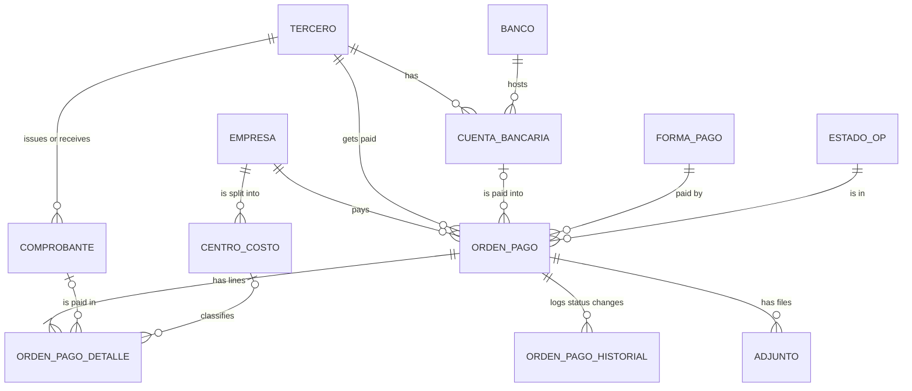

# Data model

Three schemas in one PostgreSQL database:

| Schema | Purpose |
|---|---|
| `pagos` | Normalised operational model: payment orders, third parties, bank accounts, invoices, cost centres. |
| `tesoreria` | Bank movements (income and expenses) with an idempotent load key. |
| `bi` | Flat, stable views for dashboards. BI tools connect only here. |

## Entity-relationship diagram (`pagos`)

## Glossary (Argentine terms used as identifiers)

| Term | Meaning |
|---|---|
| OP (`orden_pago`) | Payment order: an internal document that authorises paying a supplier. |
| CUIT | 11-digit tax id; the last digit is a check digit (validated in `etl/validators.py`). |
| CBU | 22-digit bank account code; two check digits and the first 3 digits identify the bank. |
| Echeq | Electronic deferred cheque (paid on a future date). |
| `tercero` | Third party: a customer, a supplier or both. |
| `comprobante` | Invoice or voucher. |

## Design decisions

1. **One record for customers and suppliers.** A company that sells to you and buys from you has one CUIT and one row in `tercero`, with role flags (`es_proveedor`, `es_cliente`), as in an ERP. `alias` (text array, GIN-indexed) holds alternative names and tax ids, so a loader can resolve spelling variants to the same supplier.
2. **No stored totals.** The total of an OP is the sum of its lines (`pagos.v_orden_pago`). A stored total can drift from the lines; a view cannot. A test also checks this.
3. **Lines carry the cost centre.** A single invoice can serve two businesses inside one legal entity, so the cost centre belongs to the line, not to the OP. A trigger rejects a centre that belongs to another company.
4. **Status history.** `estado_id` holds the current status; `orden_pago_historial` keeps every change. A rule checks that both always agree.
5. **Messy free text becomes a catalogue.** Payment methods and banks were free text with many spellings. They are lookup tables (`forma_pago`, `banco`), and the original wording is kept in `condicion_detalle` and `plazo`.
6. **Invoices are independent from OPs.** One invoice can be paid in several OPs (partial payments), so `comprobante` has its own table and lines reference it.
7. **Constraints do real work.** `CHECK` on CUIT and CBU formats, a partial unique index on `(tercero_id, cbu)`, `UNIQUE (empresa_id, nro_op)`, and `nro_op` nullable for OPs that receive their number on payment day.
8. **Idempotent treasury load.** A bank movement is identified by `(account, date, debit, credit, occurrence)`. `occurrence` numbers identical movements of the same day, so reloading a statement duplicates nothing and legitimately repeated movements (such as several identical bank fees) are kept.
9. **BI isolation.** Dashboards read `bi.*` views with stable column names. The model can evolve without breaking the dashboards, and bank details are never exposed there.

## Data-quality rules

`db/tests/data_quality.sql` returns, for each rule, the number of rows that break it. All must be zero:
paid date only on paid OPs, every OP has lines and history, last history status equals the OP status, CBU bank equals the account bank, OP account and invoices belong to the OP supplier, no repeated aliases, only suppliers are paid, no repeated OP number per company, cost centre belongs to the OP company, and the treasury running balance matches the movements.
